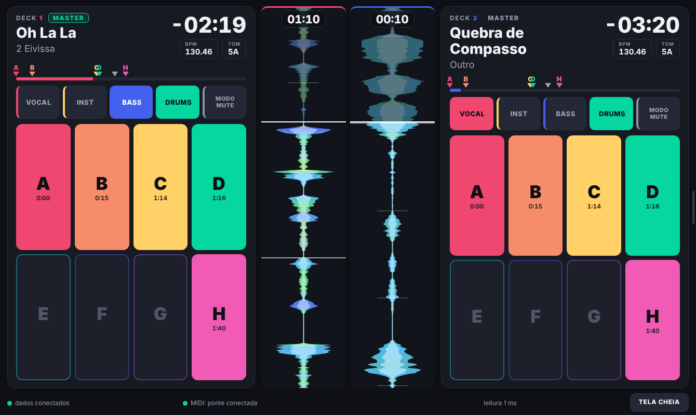
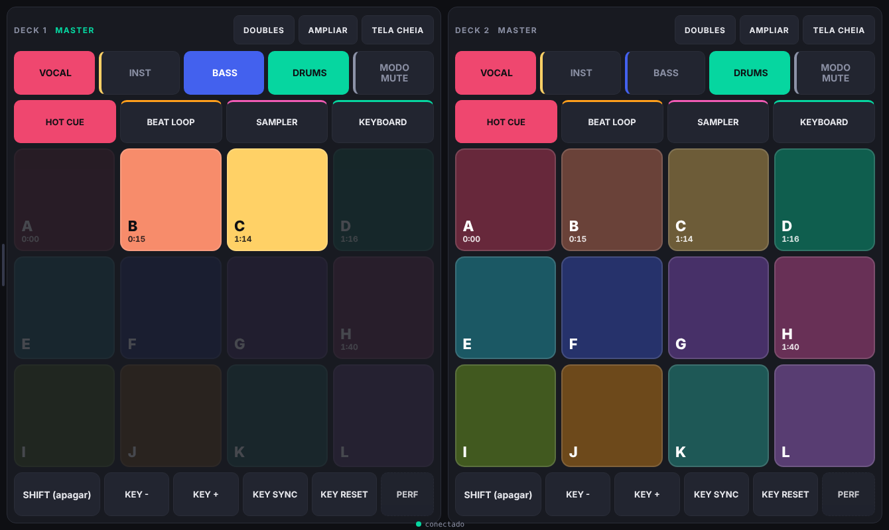

# PadBridge v2

Uma segunda tela para o **Rekordbox**, no tablet, ao lado do seu controlador DJ: **a waveform da faixa inteira de cada deck** (com agulha e o que já tocou escurecido), dados das faixas, cues, stems e pads, tudo em uma página só.



Deslizando da borda para o lado, a tela dos **pads** (a do [PadBridge v1](https://github.com/lucasrpasquetto/rekordbox-android-padbridge)) vem embutida na mesma página:



> Projeto independente, sem vínculo com a Pioneer DJ / AlphaTheta. Rekordbox é marca dos seus donos. O programa só **lê** o que o Rekordbox já mostra na tela e o banco de dados dele; nada é gravado nem modificado.

## O que mostra
- **Dados de cada deck** em tempo real: título, artista, tempo restante, BPM ao vivo (acompanha o pitch), tonalidade, barra de progresso e qual deck é o **MASTER**.
- **Waveform da faixa inteira**, horizontal e colorida, acima da barra de progresso de cada deck: uma linha branca marca o ponto atual e a parte já tocada fica escurecida. Tempo restante, tempo atual, BPM e tom ao lado do título.
- **Seek na waveform**: libere o botão **SEEK** (vem travado, para um toque sem querer não mudar a música ao vivo) e arraste o dedo na waveform; o Rekordbox pula para o ponto tocado (Needle Search, 14 bits). Mostra o tempo de destino enquanto você arrasta. Requer reimportar `PadBridge.midi.csv` do v1.
- **Cues**: hot cues A–H com letra e cor do pad, memory cues e loops, com setas e letras acima da waveform, na posição proporcional, e linhas na própria waveform. Cue criado durante o set aparece em ~2 s.
- **5 botões de stems** (VOCAL, INST, BASS, DRUMS e MODO mute/solo) e **8 pads de hot cue** por deck, com o tempo de cada cue.
- **Tela de pads** completa do v1 (Hot Cue, Beat Loop, Sampler, Keyboard, SHIFT, KEY, PERF...), a um deslize de distância.
- Botão de **tela cheia**.

## Como funciona
| Dado | Fonte |
|---|---|
| Título, artista, BPM, tom, tempos, posição | Acessibilidade do Windows (UI Automation): lê os textos da janela do Rekordbox (~60 ms por leitura) |
| Waveform, grade de batidas | Arquivos de análise `ANLZ` do Rekordbox, achados pelo `master.db` |
| Hot cues, memory cues, loops | Tabela `DjmdCue` do `master.db` (somente leitura) |
| Toques nos pads/stems e estado de volta | MIDI, pela ponte do **PadBridge v1** (loopMIDI) |

O **PRO DJ LINK** foi testado e **não** serve: sem hardware Pioneer o Rekordbox não publica o status dos decks (detalhes em [docs/DIARIO.md](docs/DIARIO.md)).

## Requisitos
- Windows com Rekordbox 7 (testado na 7.2.19) e o [PadBridge v1](https://github.com/lucasrpasquetto/rekordbox-android-padbridge) funcionando (loopMIDI + mapeamento importado; reimporte o `PadBridge.midi.csv` atual para o botão MODO).
- Python 3 com `pip install -r requirements.txt` (aiohttp, pywinauto).
- Para a waveform e os cues: um Python com `pyrekordbox` (e suporte a SQLCipher) acessível ao programa. Se o seu Python global não tiver, crie um venv (por exemplo 3.12) e passe `--python-db caminho\python.exe`, ou defina `PADBRIDGE_PYTHON_DB`. Sem isso, rode com `--sem-onda`: só os dados dos decks e os botões funcionam.
- Tablet Android com navegador moderno (Chrome), na mesma rede ou por USB.

## Usar
```
python -m padbridge2              # servidor na porta 8766
python -m padbridge2 --terminal   # só imprime os decks no terminal
```
No tablet: USB com `adb reverse tcp:8766 tcp:8766` e `http://localhost:8766`, ou Wi-Fi em `http://<IP do PC>:8766` (o endereço aparece ao iniciar; libere a porta no Firewall). A ponte do v1 usa a porta 8765 (`?midi=PORTA` na URL muda isso).

Erros inesperados do servidor ficam em `padbridge2.log`.

## Desenvolvimento
- `python tests\test_leitor.py`, `test_estado.py`, `test_onda.py`, `test_tela.py` (esta usa Playwright).
- Os testes de waveform/tela usam os arquivos de análise de uma faixa pessoal (`tests/fixtures/anlz/`, fora do repositório); sem eles esses testes são pulados.
- A tela de pads vem do HTML do v1: `python tools\gera_pads.py ..\PadBridge\padbridge\web\index.html` regenera o trecho embutido.
- `sondas/` tem os scripts usados para investigar o Rekordbox (UI Automation, PRO DJ LINK, BPM, cues).

## Licença
MIT. Veja [LICENSE](LICENSE).
